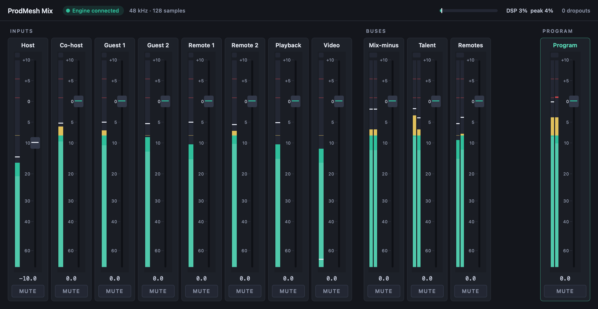

# ProdMesh Mix

A live-first DAW: a broadcast mixing console that records every source and
the program mix as a side effect, with Pro Tools-class depth and
Logic/Ableton-class approachability.

**Status:** exploratory spike. Phase 1 (engine proof) passed; phase 2 (engine daemon + mixer UI) in progress.

- Product & architecture spec: <https://claude.ai/code/artifact/29d16b59-0e7e-4695-bd7d-aaf298e414f2>
- Phase 1 results: [docs/phase1-results.md](docs/phase1-results.md)
- Contributor / agent guide: [AGENTS.md](AGENTS.md)

## What exists

A C++20 real-time mix engine that applies live graph edits — inserting a
processor, re-routing, adding or removing channels — without a click on the
edited path and without touching a single sample on any other path. A
benchmark runs the Tier 0 reference load (gate, HPF, 4-band EQ, compressor
per channel; EQ, compressor, limiter per bus) on a simulated real-time clock
or a CoreAudio device.



## Run

```bash
./build/mixd --driver coreaudio --audible
```

```bash
open build/ProdMeshMix.app
```

## Build

Requires CMake 3.24+, Ninja, a C++20 compiler (Apple clang 17 tested) and Qt 6 for the daemon and UI.

```bash
cmake -S . -B build -G Ninja && cmake --build build
```

```bash
./build/mix-tests
```

```bash
./build/mix-bench --driver sim --paths 64 --rate 48000 --block 128 --seconds 20 --edits 4
```

## License

MIT. See [LICENSE](LICENSE).
